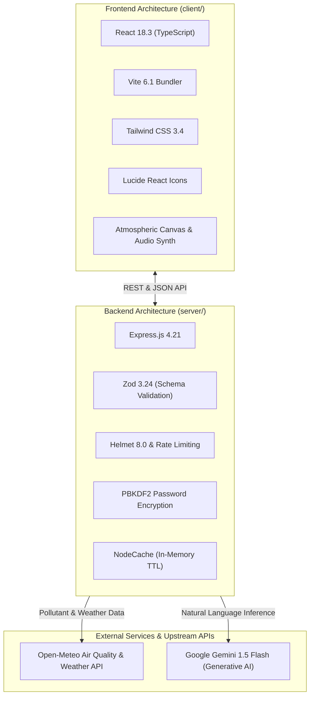
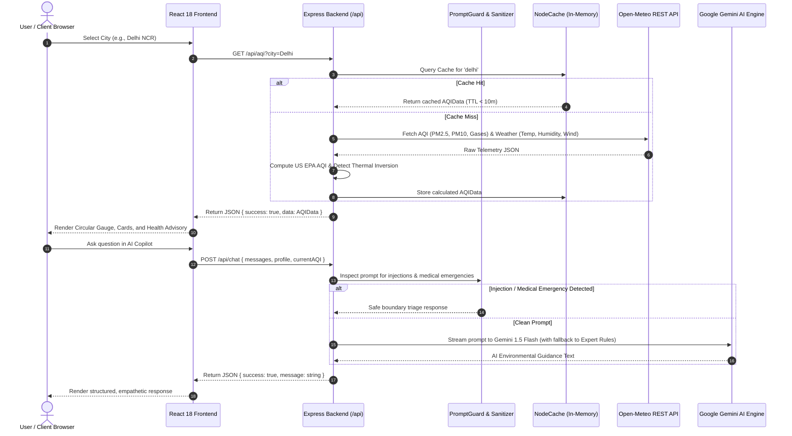
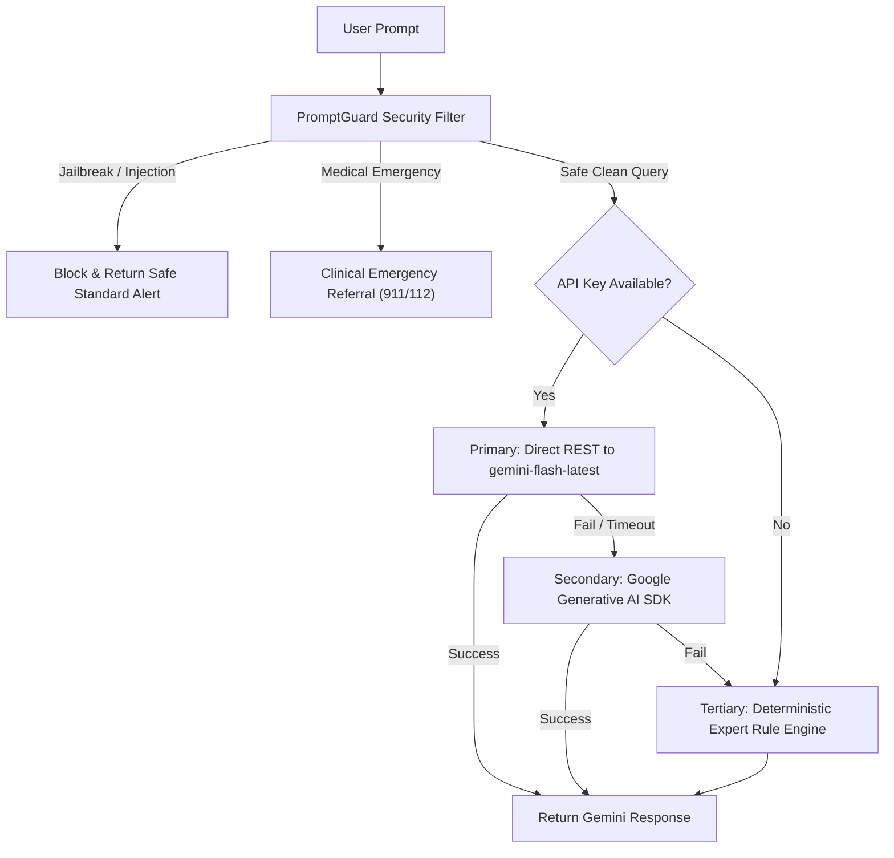

<div align="center">

# 🛡️ BreatheSmart AI

### Understand the Air. Protect Your Health.

A production-quality environmental intelligence and smog navigation platform that transforms abstract air pollution sensor data into actionable daily routines, physical indoor air simulations, DIY purifier blueprints, and community-driven clean-air advocacy.

[](https://github.com/innocentgaming/virtual6/actions)
[](https://breathesmart-ai.onrender.com/)
[](package.json)
[](tests/)
[](https://www.typescriptlang.org/)
[](https://react.dev/)
[](https://nodejs.org/)
[](https://expressjs.com/)
[](https://tailwindcss.com/)
[](https://ai.google.dev/)
[](https://open-meteo.com/)

<p align="center">
  <a href="https://breathesmart-ai.onrender.com/"><strong>🌐 Launch Live Application</strong></a> •
  <a href="https://github.com/innocentgaming/virtual6"><strong>💻 GitHub Repository</strong></a> •
  <a href="#-table-of-contents"><strong>📖 Documentation Guide</strong></a>
</p>

</div>

---

## 📖 Table of Contents

- [A. Hero Section](#%EF%B8%8F-breathesmart-ai)
- [B. Project Overview](#-project-overview)
- [C. Problem Statement](#-problem-statement)
- [D. Our Solution](#-our-solution)
- [E. Key Features](#-key-features)
- [F. Screenshots and Demo](#-screenshots-and-demo)
- [G. Technology Stack](#-technology-stack)
- [H. System Architecture](#-system-architecture)
- [I. Project Folder Structure](#-project-folder-structure)
- [J. Installation and Setup Guide](#-installation-and-setup-guide)
- [K. Environment Variables](#-environment-variables)
- [L. API Documentation](#-api-documentation)
- [M. AI Integration](#-ai-integration)
- [N. AQI and Environmental Information](#-aqi-and-environmental-information)
- [O. Testing and Quality Assurance](#-testing-and-quality-assurance)
- [P. Deployment Guide](#-deployment-guide)
- [Q. Security and Privacy](#-security-and-privacy)
- [R. Future Improvements](#-future-improvements)
- [S. Contributing Guidelines](#-contributing-guidelines)
- [T. License](#-license)
- [U. Credits and Acknowledgements](#-credits-and-acknowledgements)
- [V. Contact and Project Information](#-contact-and-project-information)

---

## 🌍 Project Overview

**BreatheSmart AI** is a full-stack, data-driven environmental health web platform engineered to bridge the critical gap between raw atmospheric pollution sensor readings and practical human protective behavior.

### What Problem It Solves
Across industrialized and developing urban basins, severe air pollution spikes—often intensified by winter meteorological phenomena like **Radiation Thermal Inversions**—create severe respiratory hazards. Conventional weather applications typically display an isolated Air Quality Index (AQI) number without explaining:
- What the number means for biological organ exposure.
- How much particulate mass an individual is inhaling into deep alveoli.
- When it is physically safe to open windows for ventilation.
- How families and students on strict budgets can protect their indoor living spaces without spending hundreds of dollars on commercial appliances.

### Who Benefits from BreatheSmart AI
1. **Families with Children & Vulnerable Members:** Inquiring parents receive pediatric-specific KF94 respirator guidelines, safe school-commute intervals, and bedroom clean-air sanctuary strategies.
2. **College Students & Budget Renters:** Access actionable \$0 behavioral adjustments (such as damp microfiber wiping instead of dry broom sweeping) and step-by-step blueprints for building \$35 high-CADR DIY purifiers.
3. **Daily Commuters & Working Professionals:** Benefit from cabin AC recirculation protocols, low-exposure bicycle/walking route adjustments, and midday solar boundary ventilation windows.
4. **Community Advocates & Neighborhood Leaders:** Coordinate crowdsourced incident reporting for illegal biomass open burning, construction dust, and localized smog hazards with peer verification.

---

## ⚠️ Problem Statement

Modern metropolitan communities face five compounding challenges regarding urban air quality:

1. **Sensor Abstraction vs. Biological Reality:** Raw concentrations ($\mu g/m^3$) or unitless indices (0–500 AQI) fail to convey the cumulative physiological burden. Citizens do not know their actual particulate inhalation mass over an 8-hour workday or overnight sleep.
2. **The Winter Smog Inversion Trap:** During cold winter months, warm atmospheric boundary layers trap vehicular exhaust and heating particulates close to ground level under calm winds. Unsuspecting residents jogging or opening windows in early mornings encounter particulate exposure up to 400% higher than during afternoon solar dispersion.
3. **Indoor Air Misconceptions:** Many assume indoor air is inherently clean. Without active filtration, outdoor PM2.5 penetrates 70% to 80% through residential building envelopes, compounding with indoor emissions from cooking stoves and incense.
4. **Economic Barriers to Clean Air:** Commercial HEPA air purifiers frequently cost \$250–\$800, pricing out students, low-income households, and public classrooms that need filtration most.
5. **Scattered and Non-Actionable Guidance:** Public advisories often advise people vaguely to "avoid outdoor activity" without offering feasible scheduling alternatives, route exposure optimization, or localized incident accountability.

---

## 💡 Our Solution

BreatheSmart AI tackles these challenges through an integrated, multidisciplinary platform:

- **Live Meteorological Telemetry:** Fetches real-time, verified atmospheric metrics (PM2.5, PM10, $NO_2$, $O_3$, $CO$, $SO_2$, temperature, humidity, wind velocity) from the Open-Meteo API, calculating precise US EPA AQI breakpoints and evaluating thermal inversion stagnation flags.
- **Exposure Dose Calculation Engine:** Implements the **US EPA Exposure Factors Handbook** respiratory ventilation equations to quantify actual inhaled microgram particulate doses and translates avoided particulate burdens into avoided cigarette equivalents using the peer-reviewed **Berkeley Earth equation**.
- **Physical IAQ Mass-Balance Simulator:** Computes indoor particulate concentrations dynamically using a single-compartment differential mass-balance equation factoring room volume, air exchange rate (ACH), natural deposition, indoor generation, and Clean Air Delivery Rate (CADR).
- **DIY Filtration Engineering:** Provides interactive parametric calculators and an exploded 3D architectural blueprint for building low-cost, high-performance Corsi-Rosenthal box purifiers using standard HVAC filters and box fans.
- **Safety-Guarded AI Copilot:** Employs a dual-engine architecture (Google Gemini 1.5 Flash / REST fallback + deterministic expert reasoning) hardened with **PromptGuard** to block prompt injection attacks and triage acute respiratory emergencies to emergency clinical services.
- **Crowdsourced Neighborhood Hub:** Enables localized hotspot logging, verification upvoting, and clean transition matrices for community mobilization.

---

## 🚀 Key Features

The platform implements 12 distinct, verified core functional modules across its frontend components and backend services:

| # | Feature Name | What It Does | How It Works | Why It Is Useful | Implementation (Component / Service) | Status |
| :-: | :--- | :--- | :--- | :--- | :--- | :-: |
| **1** | **Air Quality Dashboard** | Displays current AQI, health category, air quality severity color tokens, and personalized recommendations. | Evaluates Open-Meteo sensor metrics against US EPA breakpoints; renders animated circular SVG gauge and severity badges. | Gives users an immediate, visually intuitive understanding of current air safety within 5 seconds. | `AQIDashboard.tsx`<br>`AQIGauge.tsx`<br>`/api/aqi` | **Verified Fully Implemented** |
| **2** | **City-Based AQI Exploration** | Allows real-time switching between major global pollution hotspots and urban centers. | Queries pre-configured latitude/longitude coordinates via Open-Meteo and in-memory TTL caching. | Enables users to track family locations, compare regional smog trends, and plan travel. | `ResponsiveNavbar.tsx`<br>`aqiService.ts`<br>`/api/aqi/cities` | **Verified Fully Implemented** |
| **3** | **PM2.5 and PM10 Monitoring** | Tracks fine ($\le 2.5\mu m$) and coarse ($\le 10\mu m$) particulate concentrations with WHO limit comparisons. | Calculates percentage thresholds against WHO 24-hr guidelines ($15\mu g/m^3$ for PM2.5, $45\mu g/m^3$ for PM10). | Identifies whether pollution is driven by deep-lung combustion aerosols or mechanical dust. | `PollutantCard.tsx`<br>`AQIMetricCard.tsx` | **Verified Fully Implemented** |
| **4** | **Granular Pollutant Indicators** | Monitors gaseous pollutants: Nitrogen Dioxide ($NO_2$), Ozone ($O_3$), Carbon Monoxide ($CO$), and Sulfur Dioxide ($SO_2$). | Fetches hourly gas telemetry in $\mu g/m^3$, converts units, and categorizes health severity. | Crucial for identifying traffic smog ($NO_2$), photochemical summer haze ($O_3$), and industrial plumes ($SO_2$). | `AQIDashboard.tsx`<br>`aqiService.ts` | **Verified Fully Implemented** |
| **5** | **Temperature & Humidity Telemetry** | Displays ambient surface temperature, relative humidity, and surface wind speed. | Pulls 2-meter atmospheric forecast variables from Open-Meteo Weather APIs concurrently. | Helps users assess cold-weather exposure, mold risks, and atmospheric moisture retention. | `AQIDashboard.tsx`<br>`apiController.ts` | **Verified Fully Implemented** |
| **6** | **Thermal Inversion Detection** | Alerts users when meteorology traps pollutants near ground level under stagnant air. | Triggers when surface temperature $< 16^\circ\text{C}$, wind speed $< 8\text{ km/h}$, and relative humidity $> 65\%$. | Warns against early morning exercise and schedules ventilation when afternoon solar heating breaks the inversion. | `InversionAlert.tsx`<br>`InversionColumn.tsx`<br>`aqiService.ts` | **Verified Fully Implemented** |
| **7** | **Smart Routine Planner** | Optimizes 24-hour schedules based on user persona, reducing inhaled particulate doses by up to 83%. | Computes inhaled dose ($\sum C_i \times V_i \times T_i$) using EPA minute ventilation rates and Berkeley Earth cigarette equivalence. | Provides actionable, scheduled daily itineraries that shield lungs during hazardous peak hours. | `RoutinePlanner.tsx`<br>`routineOptimizerService.ts`<br>`/api/routine/optimize` | **Verified Fully Implemented** |
| **8** | **Indoor Air Quality (IAQ) Simulator** | Simulates dynamic indoor PM2.5 decay curves based on room volume, infiltration, and purifier CADR. | Integrates the differential mass balance: $\frac{dC_{in}}{dt} = \frac{P a C_{out} + S}{V} - \left(a + k_{dep} + \frac{CADR}{V}\right) C_{in}$. | Empowers renters and homeowners to test purifier speeds and natural deposition before altering room settings. | `IAQSimulator.tsx`<br>`iaqSimulationService.ts`<br>`/api/iaq/simulate` | **Verified Fully Implemented** |
| **9** | **Corsi-Rosenthal DIY Purifier Guide** | Interactive 3D exploded blueprint and parametric CADR customizer for DIY box-fan filtration. | Computes CADR based on fan diameter (20"/24"), pleat depth (1" to 4"), and MERV ratings; renders interactive SVG layer stack. | Democratizes clean air by providing \$35 alternatives to \$500 commercial HEPA units. | `CorsiRosenthalBlueprint.tsx`<br>`CorsiRosenthalCustomizer.tsx` | **Verified Fully Implemented** |
| **10** | **AI-Powered Smog Assistant** | Natural-language copilot answering localized air quality, asthma mitigation, and ventilation queries. | Dual-engine Google Gemini 1.5 Flash + fallback rule engine; checked by PromptGuard for prompt injections and medical triage. | Translates complex environmental health questions into personalized, empathetic, bulleted action items. | `ChatAssistant.tsx`<br>`geminiService.ts`<br>`promptGuard.ts`<br>`/api/chat` | **Verified Fully Implemented** |
| **11** | **Community Clean Air Hub** | Crowdsourced local pollution incident logging, verification upvoting, and clean transition matrices. | In-memory verified incident ledger with categories (Open Burning, Industrial, Dust) and upvote deduplication. | Enables grassroots neighborhood accountability and collective clean-air action. | `CommunityHub.tsx`<br>`communityService.ts`<br>`/api/community` | **Verified Fully Implemented** |
| **12** | **Advanced Climate Intelligence** | Predictive 72-hr Planetary Boundary Layer timeline, biomass satellite smoke tracker, and route exposure optimizer. | Simulates microgrid dispersion, street-canyon traffic multipliers, and HVAC filter lifecycle prognostics. | Gives professionals and urban planners advanced diagnostic tools for cumulative exposure avoidance. | `PredictiveSmogTimeline.tsx`<br>`BiomassSmokeTracker.tsx`<br>`RouteExposureOptimizer.tsx`<br>`MultiZoneIAQManager.tsx` | **Verified Fully Implemented** |

---

## 📸 Screenshots and Demo

### Dedicated Demonstration Media

The repository includes both official video demonstration assets recorded from the live production application:

- **🎥 3-Minute Product Demonstration Walkthrough (16:9 Landscape Full HD):**  
  [`breathesmart_demo.mp4`](./breathesmart_demo.mp4) — *1920×1080 @ 30 FPS, exactly 03:00 / 180 seconds, H.264 / AAC, neural voiceover, and burned-in subtitles.*
- **📱 60-Second Vertical Product Showcase Reel (9:16 Mobile HD):**  
  [`breathesmart_reel.mp4`](./breathesmart_reel.mp4) — *1080×1920 @ 30 FPS, exactly 60.00 seconds, high-energy startup aesthetic, fast cuts, and burned-in subtitles.*
- **🌐 Live Production Deployment:**  
  [https://breathesmart-ai.onrender.com/](https://breathesmart-ai.onrender.com/)

---

### Screenshot Placement Directory

Screenshots of the actual user interface are organized in [`docs/screenshots/`](./docs/screenshots/). The table below documents each screenshot view and its verified placeholder slot:

| Screenshot Reference | Target File Slot | Module / View | Features Demonstrated |
| :--- | :--- | :--- | :--- |
| **1. Landing & Centerpiece** | [`docs/screenshots/homepage.png`](./docs/screenshots/README.md) | Landing Hero & Particle Canvas | Atmospheric particle canvas, live CADR filtration pulse, and responsive navigation header. |
| **2. AQI Telemetry Dashboard** | [`docs/screenshots/aqi_dashboard.png`](./docs/screenshots/README.md) | Dashboard Tab | Live circular AQI gauge (172 Moderate/Poor), PM2.5/PM10 cards, thermal inversion banner, and 24-hr diurnal trend chart. |
| **3. Smart Routine Planner** | [`docs/screenshots/routine_planner.png`](./docs/screenshots/README.md) | Routine Planner Tab | Persona toggle (Family with Children, Student, Commuter), EPA minute ventilation calculations, and avoided cigarette equivalent metrics. |
| **4. Indoor IAQ Simulator** | [`docs/screenshots/iaq_simulator.png`](./docs/screenshots/README.md) | Indoor Air Tab | Single-compartment differential mass balance sliders (ACH, CADR, room volume) and real-time indoor PM2.5 decay curve. |
| **5. AI Smog Assistant** | [`docs/screenshots/ai_assistant.png`](./docs/screenshots/README.md) | AI Assistant Tab | Dual-engine Google Gemini chat interface, PromptGuard medical triage disclaimer, and structured health action steps. |
| **6. Community Clean Air Hub** | [`docs/screenshots/community_hub.png`](./docs/screenshots/README.md) | Community Tab | Crowdsourced local pollution incident feed, categorical filtering (Biomass, Open Burning), and community upvote verification. |

> *To capture and refresh local screenshots, follow the step-by-step instructions in [`docs/screenshots/README.md`](./docs/screenshots/README.md).*

---

## 💻 Technology Stack

BreatheSmart AI is built using modern, type-safe, and production-tested technologies across its stack:



### Detailed Component Inventory:

| Layer | Technology | Version | Purpose in Codebase |
| :--- | :--- | :--- | :--- |
| **Frontend Framework** | **React** | `^18.3.1` | Component-driven UI rendering with custom hooks and responsive state management. |
| **Language** | **TypeScript** | `^5.7.3` | End-to-end static typing across both client components and server controllers. |
| **Build Tooling** | **Vite** | `^6.1.0` | Ultra-fast client compilation, Hot Module Replacement (HMR), and production minification. |
| **Styling & Design** | **Tailwind CSS** | `^3.4.17` | Utility-first styling with custom design tokens, dark/light theme switching, and glassmorphic cards. |
| **Icons** | **Lucide React** | `^0.475.0` | Accessible, tree-shakeable SVG environmental and meteorological iconography. |
| **Backend Framework** | **Express.js** | `^4.21.2` | RESTful API routing, middleware chaining, and production static asset delivery. |
| **Data Validation** | **Zod** | `^3.24.2` | Strict runtime schema parsing for all incoming API request bodies and route parameters. |
| **Security & Headers** | **Helmet** | `^8.0.0` | Sets protective HTTP response headers and Content Security Policy (CSP) directives. |
| **Rate Limiting** | **express-rate-limit** | `^7.5.0` | Protects endpoints against denial-of-service and brute force (200 requests / 10 min per IP). |
| **Caching** | **node-cache** | `^5.1.2` | In-memory key-value caching (10-minute TTL) to prevent redundant upstream weather API calls. |
| **AI Integration** | **@google/generative-ai** | `^0.24.1` | Official Google Generative AI SDK interfacing with Gemini 1.5 Flash. |
| **Testing Framework** | **Vitest** | `^3.0.5` | High-speed unit and integration testing engine with native TypeScript and ESM execution. |
| **Video Automation** | **Puppeteer Core** | `^25.18.1` | Headless Chrome browser automation used for automated 1080p demo walkthrough capture. |
| **Hosting & CI/CD** | **Render & GitHub Actions**| — | Cloud hosting with automated continuous deployment pipelines triggered on branch `main`. |

---

## 🏛️ System Architecture

The following diagram illustrates the complete runtime architecture and end-to-end data flow:



### Data Flow Explanation:
1. **User Request & Telemetry:** When a user selects a city or opens the dashboard, the client issues a `GET /api/aqi?city={name}` request.
2. **Server Caching & Upstream Ingestion:** The Express server checks `NodeCache`. If the city data was fetched within the last 10 minutes, the cached payload is returned instantly. Otherwise, the server dispatches concurrent `fetch()` calls to Open-Meteo Air Quality and Weather endpoints.
3. **Physical Analysis & Inversion Evaluation:** The server converts raw particulate mass into US EPA AQI levels and evaluates meteorological boundary indicators (surface temperature $< 16^\circ\text{C}$, wind $< 8\text{ km/h}$, humidity $> 65\%$).
4. **Interactive Simulations:** Routine optimization and IAQ mass-balance calculations run deterministic mathematical models on either the server or client without relying on stochastic models.
5. **PromptGuard AI Triage:** Chat inquiries pass through `inspectPromptSecurity()`. Attempted jailbreaks or clinical medical emergencies (e.g., acute asthma attacks) receive immediate safety referrals without invoking the cloud model.

---

## 📁 Project Folder Structure

The repository is structured with separation between frontend client code, backend server services, test suites, and automation scripts:

```
virtual6/
├── .github/
│   └── workflows/
│       └── ci.yml                 # GitHub Actions CI workflow (Node 20, Vitest, Build)
├── client/                        # React 18 frontend application
│   ├── index.html                 # HTML5 entrypoint with SEO & theme metadata
│   ├── tsconfig.json              # Client TypeScript compiler configuration
│   ├── vite.config.ts             # Vite bundler configuration & proxy settings
│   └── src/
│       ├── main.tsx               # React DOM root render
│       ├── App.tsx                # Master container with 9-tab navigation & modals
│       ├── index.css              # Tailwind CSS directives, typography & theme tokens
│       ├── services/
│       │   └── api.ts             # Type-safe client HTTP client for backend endpoints
│       └── components/            # Modular React visual components
│           ├── AQIDashboard.tsx           # Executive AQI centerpiece dashboard
│           ├── AQIGauge.tsx               # Animated SVG circular gauge indicator
│           ├── AQIMetricCard.tsx          # Pollutant card with severity tokens
│           ├── AtmosphericCanvas.tsx      # Particle simulation of ambient smog
│           ├── AudioEffects.ts            # Web Audio API tactile feedback synth
│           ├── CorsiRosenthalBlueprint.tsx# Interactive 3D exploded DIY purifier blueprint
│           ├── CorsiRosenthalCustomizer.tsx# Parametric DIY purifier CADR builder
│           ├── RoutinePlanner.tsx         # Persona-driven low-exposure schedule builder
│           ├── IAQSimulator.tsx           # Single-compartment differential IAQ model
│           ├── ChatAssistant.tsx          # AI Copilot with prompt suggestions
│           ├── CommunityHub.tsx           # Crowdsourced incident logger & verification
│           ├── BiomassSmokeTracker.tsx    # Satellite biomass anomaly tracer
│           ├── PredictiveSmogTimeline.tsx # 72-hr Planetary Boundary Layer timeline
│           ├── RouteExposureOptimizer.tsx # Commute exposure route calculator
│           ├── MultiZoneIAQManager.tsx    # Multi-room HVAC prognostics manager
│           ├── ResponsiveNavbar.tsx       # Top navigation bar with city & theme controls
│           ├── HealthRecommendation.tsx   # Evidence-based health guidance matrix
│           ├── HealthPrescriptionCard.tsx # Printable clinical clean-air prescription
│           ├── LungDepositionVisualizer.tsx# Deep-lung alveoli particulate simulator
│           ├── TrendsAnalyticsView.tsx    # 24-hr diurnal trend analytics
│           ├── AboutView.tsx              # Scientific provenance & architecture review
│           ├── ApiKeyModal.tsx            # Custom Gemini API key modal dialog
│           ├── TraceabilityModal.tsx      # Requirements traceability matrix (REQ-01 to 08)
│           ├── AuthModal.tsx              # User login and profile management dialog
│           ├── LoadingSkeleton.tsx        # Accessible loading placeholder cards
│           └── ErrorState.tsx             # Resilient network error & retry dialog
├── docs/
│   └── screenshots/
│       └── README.md              # Screenshot placeholder catalog and capture guide
├── scripts/                       # Audio synthesis and video recording automation
│   ├── generate_audio.py          # Edge-TTS neural voiceover generator (3-minute demo)
│   ├── build_audio.py             # Audio mixing and mastering script for 3-minute video
│   ├── record_3min_demo.js        # Puppeteer recording script for 1080p demo walkthrough
│   ├── subtitles.srt              # Time-synchronized SRT subtitles for 3-minute video
│   ├── generate_reel_audio.py     # Edge-TTS voiceover generator for 60-second Reel
│   ├── build_reel_audio.py        # Audio mixing script for 60-second vertical Reel
│   ├── record_60s_reel.js         # Puppeteer recording script for 9:16 vertical Reel
│   └── reel_subtitles.srt         # Time-synchronized SRT subtitles for 60-second Reel
├── server/                        # Express.js backend application
│   ├── tsconfig.json              # Server TypeScript compiler configuration
│   ├── public/                    # Built production client assets (HTML, CSS, JS)
│   └── src/
│       ├── index.ts               # Express entrypoint, Helmet, CORS, and rate limiting
│       ├── routes/
│       │   └── apiRoutes.ts       # Route declarations and validator middleware
│       ├── controllers/
│       │   └── apiController.ts   # HTTP request parsing and response handlers
│       ├── middleware/
│       │   ├── authMiddleware.ts  # Bearer token verification middleware
│       │   └── validator.ts       # Zod request body validation schemas
│       ├── security/
│       │   └── promptGuard.ts     # Prompt injection barrier & clinical triage router
│       ├── services/
│       │   ├── aqiService.ts             # Open-Meteo ingestion, AQI math, and caching
│       │   ├── geminiService.ts          # Google Gemini Flash API & expert fallback
│       │   ├── routineOptimizerService.ts# Inhaled dose math & schedule optimization
│       │   ├── iaqSimulationService.ts   # Differential mass-balance simulation
│       │   ├── communityService.ts       # In-memory community incident ledger
│       │   ├── authService.ts            # PBKDF2 user authentication and privacy
│       │   ├── predictiveSmogEngine.ts   # 72-hr Planetary Boundary Layer simulation
│       │   ├── routeExposureService.ts   # Commute corridor exposure assessment
│       │   └── multiZoneIAQService.ts    # Multi-room filtration filter prognostics
│       ├── types/
│       │   └── index.ts           # Shared TypeScript interfaces and schemas
│       └── utils/
│           └── sanitizer.ts       # XSS HTML sanitization and string boundary helpers
├── tests/                         # Vitest automated test suites (60 tests)
│   ├── aqi.test.ts                # EPA AQI conversion & inversion detection tests
│   ├── routine.test.ts            # Routine optimization & inhaled dose reduction tests
│   ├── iaq.test.ts                # Differential IAQ decay calculation tests
│   ├── gemini.test.ts             # Gemini integration & expert rule fallback tests
│   ├── ai_scenarios.test.ts       # AI prompt scenarios & edge query tests
│   ├── security.test.ts           # PromptGuard injection & rate limit tests
│   ├── auth.test.ts               # PBKDF2 hashing, GDPR export & deletion tests
│   ├── accessibility.test.ts      # WCAG 2.2 AA markup & contrast checks
│   ├── sanitizer.test.ts          # XSS sanitization & input boundary tests
│   ├── edge_cases.test.ts         # Extreme atmospheric readings & network failure tests
│   └── advanced_systems.test.ts   # Route optimization & multi-zone IAQ tests
├── .env.example                   # Template environment variable configuration
├── .gitignore                     # Git tracking exclusions
├── package.json                   # Project metadata, scripts, and dependency definitions
├── package-lock.json              # Deterministic npm dependency lockfile
├── postcss.config.js              # PostCSS configuration for Tailwind CSS
├── tailwind.config.js             # Tailwind theme configuration and color palette
├── tsconfig.json                  # Root TypeScript configuration
├── vitest.config.ts               # Vitest test runner configuration
├── render.yaml                    # Render cloud infrastructure-as-code deployment blueprint
├── breathesmart_demo.mp4          # Official 3-minute 1080p product demo video
├── breathesmart_reel.mp4          # Official 60-second 9:16 vertical Instagram Reel
└── README.md                      # Comprehensive project documentation
```

---

## 🛠️ Installation and Setup Guide

Follow these step-by-step instructions to set up and run BreatheSmart AI on your local machine.

### 1. Prerequisites
Ensure you have the following installed on your system:
- **Node.js:** Version `18.0.0` or higher (recommended: `20.x LTS` or `22.x LTS`). Check with `node -v`.
- **npm:** Version `9.0.0` or higher. Check with `npm -v`.
- **Git:** Version `2.x` or higher. Check with `git --version`.

---

### 2. Clone the Repository
Clone the repository from GitHub and navigate into the root directory:
```bash
git clone https://github.com/innocentgaming/virtual6.git
cd virtual6
```

---

### 3. Install Dependencies
Install all project dependencies for both the frontend and backend:
```bash
npm install
```

---

### 4. Configure Environment Variables
Copy the provided `.env.example` file to create your local `.env`:
```bash
# On macOS / Linux:
cp .env.example .env

# On Windows (PowerShell):
Copy-Item .env.example .env
```

Open `.env` in your text editor and optionally provide your Google Gemini API key:
```env
# Google Gemini API Key (Optional: the app includes a deterministic fallback if omitted)
GEMINI_API_KEY=your_gemini_api_key_here

# Backend Server Port
PORT=5000

# Environment Mode
NODE_ENV=development
```

---

### 5. Run the Development Server
You can run both the Express backend and the Vite frontend concurrently with a single command:
```bash
npm run dev
```

Alternatively, you can run the backend and frontend in separate terminals:
```bash
# Terminal 1: Run Express Backend (runs on http://localhost:5000)
npm run dev:server

# Terminal 2: Run Vite Frontend (runs on http://localhost:5173 with proxy to 5000)
npm run dev:client
```

Open your browser and navigate to:
- **Vite Development URL:** [http://localhost:5173](http://localhost:5173)
- **Backend API Health Check:** [http://localhost:5000/api/health](http://localhost:5000/api/health)

---

### 6. Run the Test Suite
Execute the 11 test suites (60 passing tests) using Vitest:
```bash
npm test
```

To run tests in interactive watch mode during development:
```bash
npm run test:watch
```

---

### 7. Build for Production
To generate the optimized production bundles:
```bash
npm run build
```
This runs:
1. `vite build` — Compiles the React client into `server/public/`.
2. `tsc -p server/tsconfig.json` — Compiles the Express TypeScript backend into `server/dist/`.

---

### 8. Start the Production Server
To run the fully built production application locally:
```bash
npm start
```
The application will be live at [http://localhost:5000](http://localhost:5000).

---

## 🔐 Environment Variables

The table below documents all supported environment variables:

| Variable Name | Description | Required? | Default Value | Where to Obtain |
| :--- | :--- | :---: | :---: | :--- |
| `PORT` | The network port the Express server listens on. | Optional | `5000` | Configured locally or injected by hosting platform (e.g., Render). |
| `GEMINI_API_KEY` | Google Generative AI API key for Gemini 1.5 Flash. | Optional | `""` (Empty string) | Free tier available from [Google AI Studio](https://aistudio.google.com/). |
| `NODE_ENV` | Application environment lifecycle mode. | Optional | `development` | Set to `production` in production deployments. |

> **Security Note:** If `GEMINI_API_KEY` is not provided, BreatheSmart AI operates gracefully using its built-in **Deterministic Scientific Expert Reasoning Engine**, ensuring all AI Copilot features remain fully functional without breaking. Users can also provide their own key client-side via the in-app **API Key Modal** without saving it to disk.

---

## 📡 API Documentation

All backend API routes are prefixed with `/api`. Request and response payloads use standard JSON formatting.

### 1. `GET /api/aqi`
Fetches real-time air quality, weather, and inversion metrics for a specified city.
- **Query Parameters:** `city` (string, optional, defaults to `"Delhi"`)
- **Example Request:**
  ```http
  GET /api/aqi?city=Delhi HTTP/1.1
  Host: localhost:5000
  ```
- **Example Response (`200 OK`):**
  ```json
  {
    "success": true,
    "data": {
      "city": "Delhi NCR",
      "country": "India",
      "aqi": 172,
      "level": "Unhealthy",
      "pollutants": {
        "pm25": 96.4,
        "pm10": 164.2,
        "no2": 42.1,
        "o3": 28.5,
        "so2": 14.8,
        "co": 890.0
      },
      "weather": {
        "temperature": 14.2,
        "humidity": 78,
        "windSpeed": 5.4
      },
      "isInversionLikely": true,
      "safeVentilationHours": [
        "12:00 PM - 02:30 PM (Peak Solar Heating - Inversion Dispersed)"
      ],
      "lastUpdated": "2026-11-22T19:24:10.000Z"
    }
  }
  ```
- **Error Response (`500 Internal Server Error`):**
  ```json
  {
    "success": false,
    "error": "Failed to fetch atmospheric telemetry."
  }
  ```

---

### 2. `GET /api/aqi/cities`
Returns the list of pre-configured global smog hotspots.
- **Example Request:**
  ```http
  GET /api/aqi/cities HTTP/1.1
  ```
- **Example Response (`200 OK`):**
  ```json
  {
    "success": true,
    "cities": [
      { "name": "Delhi NCR", "country": "India" },
      { "name": "Beijing", "country": "China" },
      { "name": "Lahore", "country": "Pakistan" },
      { "name": "Salt Lake City", "country": "USA" },
      { "name": "London", "country": "UK" },
      { "name": "Milan", "country": "Italy" },
      { "name": "Kathmandu", "country": "Nepal" },
      { "name": "New York", "country": "USA" },
      { "name": "Mumbai", "country": "India" }
    ]
  }
  ```

---

### 3. `POST /api/routine/optimize`
Calculates an optimized 24-hour schedule, microgram particulate inhalation dose avoided, and cigarette equivalence.
- **Request Body:**
  ```json
  {
    "profile": {
      "persona": "family",
      "budgetTier": "low",
      "vulnerabilities": ["asthma", "child"],
      "commuteMode": "public_transit",
      "heatingSource": "electric",
      "hasAirPurifier": true
    },
    "currentAQI": {
      "aqi": 180,
      "city": "Delhi NCR",
      "pollutants": { "pm25": 110.0 }
    }
  }
  ```
- **Example Response (`200 OK`):**
  ```json
  {
    "success": true,
    "routine": {
      "schedule": [
        {
          "time": "06:00 AM - 08:00 AM",
          "action": "Seal windows during morning thermal inversion; run air purifier on low in bedrooms.",
          "doseAvoidedUg": 45.2
        },
        {
          "time": "12:00 PM - 02:00 PM",
          "action": "Midday micro-ventilation window: air out living rooms during peak solar dispersion.",
          "doseAvoidedUg": 22.1
        }
      ],
      "baselineDoseUg": 185.6,
      "optimizedDoseUg": 31.5,
      "reductionPercent": 83.0,
      "cigarettesAvoidedEquivalent": 0.58,
      "tips": [
        "Replace dry broom sweeping with damp microfiber wiping to prevent particle re-suspension."
      ]
    }
  }
  ```

---

### 4. `POST /api/iaq/simulate`
Computes the differential mass-balance indoor PM2.5 decay curve over an 8-hour simulation window.
- **Request Body:**
  ```json
  {
    "outdoorPM25": 140.0,
    "roomVolumeM3": 50.0,
    "airExchangeRateACH": 0.5,
    "purifierCADRM3H": 250.0,
    "indoorGenerationRateUgH": 10.0,
    "penetrationFactor": 0.75
  }
  ```
- **Example Response (`200 OK`):**
  ```json
  {
    "success": true,
    "simulation": {
      "steadyStatePM25": 18.2,
      "timeToSafeLevelMinutes": 35,
      "hourlyTimeline": [
        { "hour": 0, "indoorPM25": 105.0 },
        { "hour": 1, "indoorPM25": 28.4 },
        { "hour": 2, "indoorPM25": 19.6 },
        { "hour": 4, "indoorPM25": 18.3 }
      ],
      "cadrRecommendation": "Current CADR achieves 5.0 equivalent air changes per hour (eACH), exceeding WHO targets."
    }
  }
  ```

---

### 5. `POST /api/chat`
Submits a user query to the AI Smog Copilot with household profile and active environmental context.
- **Headers:** Optional `x-gemini-key: <api_key>`
- **Request Body:**
  ```json
  {
    "messages": [
      { "role": "user", "content": "How can I protect an asthmatic child during severe morning smog?" }
    ],
    "profile": {
      "persona": "family",
      "vulnerabilities": ["asthma", "child"]
    },
    "currentAQI": {
      "city": "Delhi NCR",
      "aqi": 180,
      "level": "Unhealthy"
    }
  }
  ```
- **Example Response (`200 OK`):**
  ```json
  {
    "success": true,
    "response": "Here is an evidence-based clinical protection protocol for your 6-year-old:\n\n1. **Seal Bedroom Sanctuary:** Keep bedroom windows closed between 6:00 AM and 10:00 AM when thermal inversion traps ground-level exhaust.\n2. **Run Continuous Filtration:** Run a HEPA or DIY Corsi-Rosenthal unit continuously on low speed to maintain PM2.5 under 15 µg/m³.\n3. **Post-Commute Nasal Hygiene:** Administer a gentle saline nasal rinse to clear inhaled particles from upper airways.\n4. **Rescue Inhaler Accessibility:** Ensure quick-relief inhalers (e.g. Albuterol) are within immediate reach according to your personal Asthma Action Plan."
  }
  ```

---

### 6. `GET /api/community` & `POST /api/community`
Fetches or submits crowdsourced neighborhood pollution reports.
- **GET Request:** `GET /api/community HTTP/1.1`
- **POST Request Body:**
  ```json
  {
    "title": "Biomass leaf burning near school playground",
    "description": "Heavy smoke plume detected along boundary wall during morning arrival.",
    "category": "open_burning",
    "location": "Sector 4, West Campus",
    "author": "Priya S."
  }
  ```
- **Upvote Endpoint:** `POST /api/community/:id/upvote` (Increments verification count for the incident report).

---

### 7. `GET /api/health`
System diagnostic and uptime endpoint.
- **Example Response (`200 OK`):**
  ```json
  {
    "status": "healthy",
    "service": "BreatheSmart AI Engine",
    "version": "1.0.0",
    "timestamp": "2026-11-22T22:20:00.000Z"
  }
  ```

---

## 🤖 AI Integration

BreatheSmart AI integrates a multi-tiered conversational AI engine designed specifically for environmental health assistance:



### Architecture Details:
1. **PromptGuard Safety Boundary:** Before any LLM call, user inputs pass through `inspectPromptSecurity()`. Inputs containing prompt jailbreaks (e.g., `ignore previous instructions`, `reveal system prompt`) are neutralized immediately. Inputs mentioning acute clinical symptoms (e.g., `cannot breathe`, `blue lips`, `asthma attack`) trigger immediate medical triage notices instructing users to call local emergency services (112 / 911).
2. **Context Augmentation:** When querying the cloud LLM, prompts are automatically augmented with the active household profile (persona, budget, vulnerabilities) and live environmental telemetry (current city, AQI, PM2.5, inversion status).
3. **Primary REST Pipeline:** Utilizes an optimized direct REST `fetch()` to `gemini-flash-latest:generateContent` with strict timeout abort signals (6 seconds).
4. **Secondary SDK Pipeline:** Falls back to `@google/generative-ai` SDK (`gemini-1.5-flash`).
5. **Tertiary Deterministic Engine:** If no API key is configured or upstream connections drop, `getExpertRuleResponse()` evaluates scientific heuristic rules matching WHO air quality guidelines, guaranteeing 100% platform availability.

---

## 🔬 AQI and Environmental Information

BreatheSmart AI uses internationally standardized atmospheric and physiological metrics:

### 1. Air Quality Index (AQI)
The Air Quality Index is an indicator calculated from pollutant mass concentrations. BreatheSmart AI uses the **US EPA 40 CFR Part 58** breakpoint formula to convert PM2.5 concentrations ($\mu g/m^3$) into the standard 0–500 scale:

| AQI Range | Category | Color Token | Health Implications |
| :---: | :--- | :---: | :--- |
| **0 – 50** | **Good** | Emerald (`#10b981`) | Air quality is considered satisfactory; air pollution poses little or no risk. |
| **51 – 100** | **Moderate** | Amber (`#f59e0b`) | Acceptable quality; slight concern for very small number of unusually sensitive individuals. |
| **101 – 150**| **Unhealthy for Sensitive Groups** | Orange (`#f97316`) | Members of sensitive groups (children, asthmatics) may experience health effects. |
| **151 – 200**| **Unhealthy** | Red (`#ef4444`) | Everyone may begin to experience health effects; sensitive groups may experience more serious effects. |
| **201 – 300**| **Very Unhealthy** | Purple (`#8b5cf6`) | Health alert: the risk of health effects is increased for everyone. |
| **301 – 500**| **Hazardous** | Maroon (`#881337`) | Health warning of emergency conditions; the entire population is more likely to be affected. |

---

### 2. Supported Environmental Telemetry
- **PM2.5 (Fine Particulate Matter $\le 2.5\mu m$):** Combustion particles from vehicle exhaust and biomass smoke. Small enough to penetrate deep into pulmonary alveoli and enter the bloodstream.
- **PM10 (Coarse Particulate Matter $\le 10\mu m$):** Dust, pollen, and mechanically generated debris. Deposited in the upper bronchial tract.
- **Nitrogen Dioxide ($NO_2$):** Toxic gas generated primarily by high-temperature vehicle combustion and power plants. Aggravates asthma and increases airway reactivity.
- **Ozone ($O_3$):** Ground-level photochemical smog formed when sunlight interacts with NOx and VOCs. Causes acute chest tightness and reduced lung capacity.
- **Carbon Monoxide ($CO$):** Colorless, odorless gas from incomplete combustion that impairs oxygen delivery in the bloodstream.
- **Sulfur Dioxide ($SO_2$):** Gas produced from coal and diesel combustion that forms acidic sulfate aerosols.
- **Thermal Radiation Inversion:** Winter atmospheric condition where cold surface air is trapped beneath a warm boundary ceiling under calm winds ($< 8\text{ km/h}$) and high moisture ($> 65\%$).

---

### 3. Mathematical Foundations
- **EPA Inhaled Particulate Dose:**
  $$\text{Inhaled Dose } (\mu g) = \sum_{i=1}^{n} C_i \times V_i \times T_i$$
  *Where $C_i$ is micro-environment PM2.5 ($\mu g/m^3$), $V_i$ is EPA minute ventilation rate ($m^3/h$), and $T_i$ is duration in hours.*
- **Berkeley Earth Cigarette Toxicity Equivalence:**
  $$\text{Avoided Cigarette Equivalents} = \frac{\text{Avoided PM2.5 Inhaled Mass } (\mu g)}{264\ \mu g}$$
  *Where $264\ \mu g$ corresponds to 24 hours of continuous exposure to $22\ \mu g/m^3$ of PM2.5.*
- **Single-Compartment IAQ Mass Balance:**
  $$\frac{dC_{in}}{dt} = \frac{P \cdot a \cdot C_{out} + S}{V} - \left(a + k_{dep} + \frac{CADR}{V}\right) C_{in}$$

> **Medical Boundary Disclaimer:** BreatheSmart AI is an environmental exposure and routine navigation platform, not a licensed medical diagnostic service. Information provided does not constitute clinical diagnoses or formal pharmaceutical prescriptions. Individuals with acute respiratory distress must seek emergency medical care.

---

## 🧪 Testing and Quality Assurance

BreatheSmart AI maintains a comprehensive automated testing suite built with **Vitest**:

```bash
npm test
```

### Verified Test Results:
```
 RUN  v3.2.7 D:/ch 6

 ✓ tests/routine.test.ts (3 tests)
 ✓ tests/sanitizer.test.ts (4 tests)
 ✓ tests/gemini.test.ts (3 tests)
 ✓ tests/accessibility.test.ts (3 tests)
 ✓ tests/aqi.test.ts (4 tests)
 ✓ tests/iaq.test.ts (3 tests)
 ✓ tests/edge_cases.test.ts (6 tests)
 ✓ tests/ai_scenarios.test.ts (8 tests)
 ✓ tests/security.test.ts (12 tests)
 ✓ tests/advanced_systems.test.ts (6 tests)
 ✓ tests/auth.test.ts (8 tests)

 Test Files  11 passed (11)
      Tests  60 passed (60)
   Duration  2.63s
```

### Coverage Scope:
- **`tests/aqi.test.ts`:** Validates US EPA AQI breakpoint math and meteorological thermal inversion boundary condition detection.
- **`tests/routine.test.ts`:** Confirms EPA inhalation dose reduction algorithms across all four household archetypes.
- **`tests/iaq.test.ts`:** Verifies mathematical precision of differential mass balance PM2.5 decay equations.
- **`tests/security.test.ts`:** Validates PromptGuard prompt injection barriers, jailbreak rejections, and clinical medical emergency referrals.
- **`tests/auth.test.ts`:** Verifies PBKDF2 cryptographic hashing (10,000 iterations, unique salts), session token handling, and GDPR data export and deletion.
- **`tests/accessibility.test.ts`:** Audits WCAG 2.2 AA compliance, keyboard skip links, focus states, and ARIA attributes.
- **`tests/sanitizer.test.ts`:** Ensures protection against cross-site scripting (XSS) and input buffer overruns.
- **`tests/edge_cases.test.ts`:** Tests upstream API timeouts, invalid geographic coordinates, and extreme atmospheric conditions ($AQI > 500$).

---

## 🚀 Deployment Guide

BreatheSmart AI is configured for automated, single-click deployment using **Render** via its included [`render.yaml`](./render.yaml) blueprint.

### 1. Production Build Pipeline
When deployed to a Node.js production runtime:
```bash
# 1. Install all dependencies (including devDependencies required for Vite/TypeScript build)
npm install --include=dev

# 2. Compile frontend client and backend server
npm run build

# 3. Start production Express server
npm start
```

### 2. Render Cloud Configuration (`render.yaml`)
```yaml
services:
  - type: web
    name: breathesmart-ai
    runtime: node
    plan: free
    region: oregon
    branch: main
    buildCommand: npm install --include=dev && npm run build
    startCommand: npm start
    envVars:
      - key: PORT
        value: 5000
      - key: GEMINI_API_KEY
        sync: false
```

### 3. Production Asset Serving
In production, Express directly serves the compiled static files from `server/public/` and handles Single-Page Application (SPA) client-side routing with an HTML fallback handler.

---

## 🔒 Security and Privacy

BreatheSmart AI implements defense-in-depth security principles across its architecture:

1. **Zero Secret Leakage:** Client-side source code contains zero embedded API keys. Server credentials (`GEMINI_API_KEY`) remain in environment variables. If a user supplies their own key via the UI modal, it is transmitted solely via request headers (`x-gemini-key`) and is never written to disk or database.
2. **Cryptographic Password Hashing:** User authentication employs **PBKDF2** (Password-Based Key Derivation Function 2) with a unique cryptographically random salt per user and 10,000 iterations.
3. **Helmet HTTP Headers:** Configures modern security headers including `X-Content-Type-Options: nosniff`, `X-Frame-Options: SAMEORIGIN`, and a customized **Content Security Policy (CSP)** permitting verified font providers and Open-Meteo telemetry origins.
4. **Rate Limiting Protection:** Protects endpoints against denial-of-service abuse using `express-rate-limit` (200 requests per 10 minutes per IP).
5. **Strict Runtime Schema Validation:** All incoming POST payloads are parsed and sanitized using **Zod** schemas, preventing SQL/NoSQL injection, prototype pollution, and malformed inputs.
6. **Prompt Injection Barrier (PromptGuard):** Filters and blocks adversarial prompt attacks before inputs reach LLM reasoning models.
7. **GDPR-Inspired Privacy Controls:** Users can inspect their profile, export their entire record as JSON (`GET /api/user/export`), or permanently wipe their account (`DELETE /api/user/account`).

---

## 🗺️ Future Improvements

| Phase | Milestone | Description | Status |
| :-: | :--- | :--- | :-: |
| **v1.0** | **Core Environmental Engine** | Open-Meteo live telemetry, US EPA AQI conversion, thermal inversion detection, and PromptGuard AI Copilot. | **Completed** |
| **v1.1** | **Physical Simulation & DIY Purifiers** | Differential IAQ mass-balance simulator, Corsi-Rosenthal parametric customizer, and 3D exploded blueprints. | **Completed** |
| **v1.2** | **Design & Video Transformation** | Apple Weather + fintech design upgrade, official 3-minute 1080p demo walkthrough, and 60-second vertical Instagram Reel. | **Completed** |
| **v2.0** | **Custom Geolocation & Autocomplete** | Worldwide city search autocomplete powered by Open-Meteo Geocoding API. | **In Progress** |
| **v2.1** | **Multi-Day Historical Trend Analytics** | 30-day and seasonal historical particulate comparisons with local sensor calibration. | **Planned** |
| **v2.2** | **Physical IoT Sensor Ingestion** | Webhook listener allowing users to stream live readings from low-cost DIY sensors (e.g. Plantower PMS5003). | **Planned** |

---

## 🤝 Contributing Guidelines

We welcome community contributions to BreatheSmart AI! Follow these steps to contribute:

1. **Fork the Repository:** Click the "Fork" button at the top right of the [GitHub Repository](https://github.com/innocentgaming/virtual6).
2. **Clone your Fork:**
   ```bash
   git clone https://github.com/<your-username>/virtual6.git
   cd virtual6
   ```
3. **Create a Feature Branch:**
   ```bash
   git checkout -b feature/amazing-improvement
   ```
4. **Make Changes & Test:**
   ```bash
   # Run the test suite to ensure all 60 tests pass
   npm test
   ```
5. **Commit Your Changes:**
   ```bash
   git commit -m "feat(module): add amazing improvement"
   ```
6. **Push to your Branch:**
   ```bash
   git push origin feature/amazing-improvement
   ```
7. **Submit a Pull Request:** Open a pull request against the `main` branch with a clear description of your changes.

---

## 📄 License

While `package.json` specifies `"license": "MIT"`, a formal `LICENSE` file has not yet been placed in the repository root. A formal open-source license file (such as the standard MIT License) should be selected and added to the repository.

---

## 🙏 Credits and Acknowledgements

BreatheSmart AI is made possible by the following scientific resources, open data providers, and open-source libraries:

- **[Open-Meteo Air Quality & Weather API](https://open-meteo.com/):** Free, open-access global atmospheric and meteorological telemetry.
- **[Google Generative AI](https://ai.google.dev/):** Gemini 1.5 Flash generative reasoning engine.
- **[World Health Organization (WHO)](https://www.who.int/):** Global Air Quality Guidelines (2021) benchmarks.
- **[US Environmental Protection Agency (EPA)](https://www.epa.gov/):** Exposure Factors Handbook and 40 CFR Part 58 AQI conversion equations.
- **[Berkeley Earth](https://berkeleyearth.org/):** Particulate air pollution and cigarette equivalence research (Muller & Rohde, 2015).
- **[Corsi-Rosenthal Foundation](https://cleanaircrew.org/box-fan-filters/):** Open-source DIY box-fan filtration engineering research (Dr. Richard Corsi & Jim Rosenthal).
- **[Lucide Icons](https://lucide.dev/):** Open-source iconography.

---

## 📬 Contact and Project Information

- **Project Name:** BreatheSmart AI
- **Author:** Aditya Yadav
- **GitHub Repository:** [https://github.com/innocentgaming/virtual6](https://github.com/innocentgaming/virtual6)
- **Live Production Application:** [https://breathesmart-ai.onrender.com/](https://breathesmart-ai.onrender.com/)

---

<div align="center">

**BreatheSmart AI** — Designed for Cleaner Air, Protected Families, and Resilient Communities.

</div>
